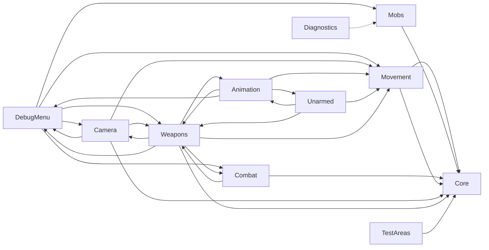

# Architecture

## Systems and ownership
| System | Folder | Owns | Page |
|---|---|---|---|
| Core | `Assets/Game/Core/` | Shared contracts only: `IDamageable`, `CombatEvents` (damage reports), `PlayerRequests` (teleport, refill ammo), `PlayerPresence` (where the player is), the movement contracts (`IMovementModifier`, `IViewHeading`, `IControlBlocker`, `PlayerControl`), the project-wide input actions asset | (this page) |
| Movement | `Assets/Game/Movement/` | Character position, velocity, movement state (walk, run, jump, crouch, roll, dive, slide, wall jump), stamina, speed readout. Own assembly, references Core only | [movement](systems/movement.md) |
| Camera | `Assets/Game/Camera/` | View yaw/pitch, aim direction, follow and collision, aim zoom, camera recoil and landing dip, free roam | [camera](systems/camera.md) |
| Animation | `Assets/Game/Animation/` | The block player character: Humanoid rig, animation graph, special-move poses, block placement, rounding | [animation](systems/animation.md) |
| Unarmed | `Assets/Game/Unarmed/` | Limb contact for punches and kicks (attack selection and timing currently sit in Animation) | [unarmed](systems/unarmed.md) |
| Weapons | `Assets/Game/Weapons/` | Equipped gun, ammo, reload, firing, weapon pose, pickups, weapon data | [weapons](systems/weapons.md) |
| Combat | `Assets/Game/Combat/` | Hit queries, the damage receiver, shot and hit feedback, combat audio volume | [combat](systems/combat.md) |
| Mobs | `Assets/Game/Mobs/` | The six block mobs: AI, attacks, animation playback, prefabs, test spawner. Own assembly, references Core only | [mobs](systems/mobs.md) |
| Debug menu | `Assets/Game/DebugMenu/`, `Assets/Game/UI/` | UI Toolkit F1 menu (equip, spawn, stamina, camera, audio, controls), shared styles and the "menu is open" input gate | this page |
| World | `Assets/Game/World/` | Grid shader and level materials, NavMesh data | [test areas](TEST_AREAS.md) |
| Test areas | `Assets/Game/TestAreas/` | Start markers, target reset, moving targets, damage numbers, shortcuts, and the area builder. Own assembly, references Core only | [test areas](TEST_AREAS.md) |
| Diagnostics | `Assets/Game/Diagnostics/` | Baseline harness: action sequences, per-frame recorder, metrics. A measuring tool that reads the baseline components directly | [feel spec](FEEL_SPEC.md) |

Third-party files used by these systems are in `Assets/ThirdParty/`. Render pipeline settings are in `Assets/Settings/`.

## Debug menu presentation

The F1 menu uses UI Toolkit. `ViewModeDebugMenu` still owns its input gate and the existing gameplay connections; its partial presentation file builds the catalogue and settings controls. This is a presentation change within the migrated baseline, not a system/assembly rebuild. Its update-order slot and the existing Core control-blocking contract are unchanged.

- Layout: `Assets/Game/UI/GameUI.uxml`; shared styling: `Assets/Game/UI/DebugMenu.uss`. Open the layout in Window > UI Toolkit > UI Builder. The supplied UIExample image is the visual reference.
- The scene's UIDocument uses `Assets/Game/UI/DebugMenuPanelSettings.asset`, which scales the menu to the Game view. Tools > Project > Set Up Debug Menu UI reconnects the document and controller if needed; save the scene afterwards.
- Weapons supports case-insensitive search, type/creator/pack filters, a selection preview, Equip Weapon, and Spawn Pickup. Other tabs retain the existing mob, stamina, camera and sound actions. The world's simulation keeps running while the menu blocks player control and releases the cursor.
- F1 toggles visibility even while search has focus. Resume and clicking outside the panel close it. Escape releases the cursor. Closing the menu clears text focus; disabling the controller also hides the UI.
- Barlow Condensed ExtraBold is bundled with its OFL license in `Assets/Game/UI/Fonts/`. The cream grid and button highlights are native UI elements/drawing.
- Play-mode interaction checks live in `Assets/Game/DebugMenu/Tests/`; the manual test route is in [test areas](TEST_AREAS.md#debug-menu).

## Dependencies today
Apart from Core, Movement, Mobs, Test areas and the editor tools, the gameplay code is the migrated baseline: it compiles into the default assembly and systems still call each other directly (arrows read "calls or reads"):

Movement gets its heading, control gate and slowdowns only through Core contracts, which the camera, debug menu, weapons and attack animation implement. Camera, animation, unarmed and weapons still read movement's public state directly (one way, allowed because Game.Movement is its own assembly); when they are rebuilt they will read it through a Core contract.

Test areas reach the game only through Core: they raise `PlayerRequests` (movement teleports, the camera re-frames, weapons refill) and listen to `CombatEvents`. Diagnostics is a measuring tool outside the dependency rules; it will read Core contracts instead once the systems it measures are rebuilt.

These loops are why systems cannot have their own assemblies yet. See [decision 0001](decisions/0001-project-structure.md).

## Dependency rules (apply to new and rebuilt code)
- Every system may depend on Core. Core depends on nothing in the game.
- Systems do not reference each other directly unless a decision record says why. They talk through Core interfaces and C# events, not by finding or reaching into each other's components.
- Assembly references never form a loop. A rebuilt system gets its own assembly that references Core only.

## Update order
The one list of what runs when. A lower number runs earlier within the same phase; all Update work happens before any LateUpdate work.

| Order | Component | Update | LateUpdate |
|---:|---|---|---|
| -120 | `ViewModeDebugMenu` | Menu and view shortcuts | |
| -100 | `FollowCamera` | Mouse look, free-roam flight | Place the camera (before the character pose is final) |
| -50 | `MaleWalkRetarget` | Read the unarmed attack click | Evaluate the animation graph, then running lean, run-arm tuck, chest aim pitch |
| -25 | `WeaponCombatController` | Aim, fire input (queues the shot), reload, pickups, HUD | |
| 0 | `CapsuleMovement` and all scripts without an order | Move the character and set its facing; `TestAreaControls` shortcuts | `MobAttackDriver` animation choice, `StaminaBar`, `SpeedReadout`; `BaselineRunner` queues the next frame's test input |
| 160 | `BlockHumanoidRig` | | Special-move poses, copy bones to blocks, ground the body, punch contact, weapon arm pose |
| 200 | `PlayerBlockRounding` | | Refresh rounded block meshes |
| 220 | `CombatFeedback` | | Resolve the queued shot from the final muzzle position, effects |
| 10000 | `BaselineRecorder` (only during a baseline run) | | Log the final state of the frame |

Known consequence: camera recoil from a shot is applied after the camera has been placed, so it shows one frame later.

## Glossary
- **Humanoid rig / avatar:** Unity's standard human skeleton description; lets clips made for one character play on another.
- **Animation graph (PlayableGraph):** clips mixed in code rather than in an Animator Controller window.
- **NavMesh:** the walkable-area map mobs use for pathfinding.
- **ScriptableObject:** a data asset (for example a WeaponSettings asset) edited in the Inspector.
- **GUID:** the ID in each `.meta` file that scenes and prefabs use to find an asset.
- **Test station:** a small, labeled area in the scene for trying one system.
